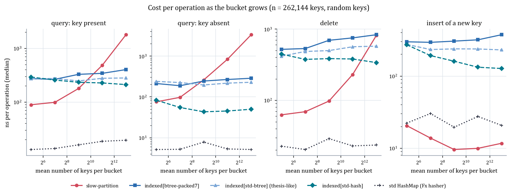

# Modern Hashing

A from-scratch Rust implementation of the hash-table constructions in **"Modern Hashing Made Simple"** (Bender, Farach-Colton, J. Kuszmaul, W. Kuszmaul, SOSA 2024), with a full test suite, a benchmark harness, and two written guides.

> **Background.** This project grew out of my university thesis, in which I implemented the paper in Java. This repository is the Rust rewrite: it follows the paper's design more closely than the Java code, adds the parts the Java version left out (the Four Russians tables, real tries, dynamic resizing) and measures everything with a careful methodology. It is based on, but not identical to, the thesis; section 10 of the implementation PDF lists the differences from the Java code.

No external crates are used: the PRNG, the test harness and the benchmark harness are all in this repository.

## What the paper is about

Hash tables with constant-time operations *with high probability*, space of `nw + O(n log log n)` bits for `n` keys of `w` bits, and dynamic resizing exist in the literature, but they are considered too intricate to teach. The paper shows that ordinary tools (buckets, B-trees, lookup tables, tries) are enough. This repository implements all four steps:

| Paper | Structure | Code |
|---|---|---|
| §3 | Slow Partition Hash Table | `src/slow.rs`, `src/partition.rs` |
| §4 | Indexed Partition Hash Table with a per-bucket *query mapper* | `src/indexed.rs`, `src/mapper/` |
| §4 | B-tree nodes, Method of Four Russians (exact tables and a practical version) | `src/mapper/btree.rs`, `src/mapper/tabulated.rs` |
| §5 | K-Tries (buffered insertions/deletions in two 256-ary tries) | `src/ktrie.rs`, `src/buffered.rs` |
| §6 | Dynamic resizing (resizable arrays, incremental global rebuild) | `src/slab.rs`, `src/resizable.rs` |

Keys and values are `u32`; every `u32` (including `0` and `u32::MAX`) is a valid key. Every table implements the `Dictionary` trait (`insert_new`, `insert`, `get`, `remove`, `len`, `capacity`, `stats`, `space`, `check_invariants`), so the same tests and benchmarks run on all of them.

## Documentation (PDF)

| Document | What it covers |
|---|---|
| [`docs/Modern_Hashing_Paper_Explained.pdf`](docs/Modern_Hashing_Paper_Explained.pdf) | A guided explanation of the paper: the problem, partition hashing, the query mapper, the Four Russians trick, K-Tries, resizing, Q&A, glossary (6 pages). |
| [`docs/Modern_Hashing_Rust_Implementation.pdf`](docs/Modern_Hashing_Rust_Implementation.pdf) | What the Rust code does and why, how it was tested, every measurement with its caveats, which of the paper's guarantees hold in practice, and how it differs from the original thesis implementation (14 pages). |

The paper itself is not redistributed here (its authors retain the copyright); read it at <https://par.nsf.gov/biblio/10581590> (DOI [10.1137/1.9781611977936.33](https://doi.org/10.1137/1.9781611977936.33)).

## Highlights

* **Correctness.** 72 tests (39 unit, 14 model-based against a `HashMap` oracle with all internal invariants checked after every operation, 19 regression tests). Two tests rely on `debug_assert!` and are skipped in release mode, where 70 pass.
* **Four Russians, twice.** The *exact* version precomputes all 37,825 states of a B-tree node, so every node operation is a table read; it is verified exhaustively and works inside a real hash table. The *practical* version keeps 7 entries per node with 128-entry rank tables equivalent to `popcount`/`ctz`.
* **What the measurements show.** An Indexed Partition query stays almost flat as buckets grow while a Slow Partition query grows linearly, which is the paper's guarantee made visible, but it only pays off with thousands of keys per bucket. K-Tries does not reduce worst-case latency because rebuilds are not interruptible. The space overhead is roughly `14·log₂log₂ n` bits per key above the 32-bit key. The exact Four Russians tables lose to a few CPU instructions. Details and caveats are in the implementation PDF.



## Build, test, benchmark

Windows (Rust GNU toolchain plus a MinGW-w64 linker such as WinLibs):

```powershell
. .\scripts\env.ps1                  # puts rustc/cargo and the MinGW linker on PATH
cargo test                           # unit, model-based and regression tests
cargo run --release --bin bench -- --quick          # a few seconds: smoke test of the harness
powershell -ExecutionPolicy Bypass -File scripts\run_benchmark.ps1 -Big   # full benchmark (about an hour), writes results\*.csv
python scripts\plot.py               # results\figures\*.png (needs matplotlib)
```

On Linux or macOS plain `cargo test` and `cargo run --release --bin bench` work; the PowerShell scripts are Windows conveniences. Run the full benchmark on an otherwise idle machine; the script pins the process to one logical CPU.

## Repository layout

```
src/lib.rs            module map and constructors (slow, indexed, ktries)
src/rng.rs            SplitMix64, scramble32 (a bijection on u32 for distinct pseudo-random keys)
src/hash.rs           2-universal hashing mod 2^61-1, multiply-shift bucket reduction
src/params.rs         the paper's geometry (log2 based): buckets, slots, fingerprint width
src/dict.rs           Dictionary trait, Stats, SpaceReport
src/partition.rs      bucket array shared by Slow and Indexed, whole-table rebuild
src/slow.rs           SlowBucket / SlowPartition
src/indexed.rs        IndexedBucket / IndexedPartition (+ SlabIndexedPartition)
src/mapper/           QueryMapper trait and five implementations
src/ktrie.rs          256-ary trie of pending operations
src/buffered.rs       K-Tries: growing and shrinking trie around any Dictionary
src/slab.rs           SlabVec: resizable array of Lemma 2.3
src/resizable.rs      Resizable: grow/shrink by incremental migration
src/bin/bench.rs      benchmark harness (experiments e1..e6)
tests/model.rs        every structure against a HashMap oracle, invariants checked after every operation
tests/regressions.rs  one named test per defect of the original Java implementation (B1..B7)
scripts/              env.ps1, run_benchmark.ps1, plot.py
results/              CSV files, figures, machine.txt, bench_log.txt
docs/                 the two PDF guides
```

## Provenance of the measurements

* `results/e1..e5` were measured with the binary built **before** Section 6 (the generic `Slots` store and the `drain_cursor` of `Partition`) was added to the source. The default (fixed-capacity) code path is the same after the change.
* `results/e6*` and `results/e1_rerun_after_section6.csv` ran on the final code. The e1 re-run came out about 2.2× slower in absolute terms because the (non-idle, thermally throttled) laptop had changed state; normalised by the `HashMap` baseline it shows no relative slowdown (median ratio 0.7–0.9).
* `results/rebuild_check/` re-runs every e2 configuration (96 runs) and shows 0 whole-table rebuilds, 0 bucket rebuilds and 0 fingerprint widenings.
* Measurements come from a laptop that was not idle, so comparisons between structures are reliable and absolute times are not.

## Reference

Michael A. Bender, Martín Farach-Colton, John Kuszmaul, William Kuszmaul. *Modern Hashing Made Simple.* Symposium on Simplicity in Algorithms (SOSA), 2024, pp. 363–373.

## License

MIT, see [`LICENSE`](LICENSE). © 2026 Evangelos Tempelopoulos.
